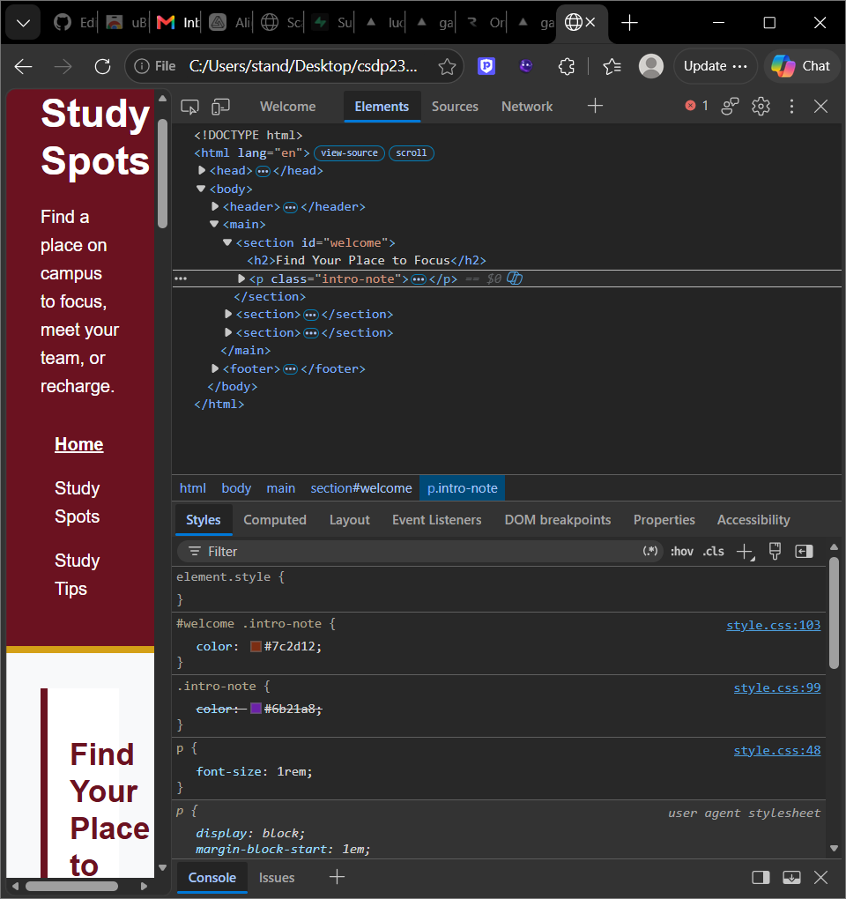
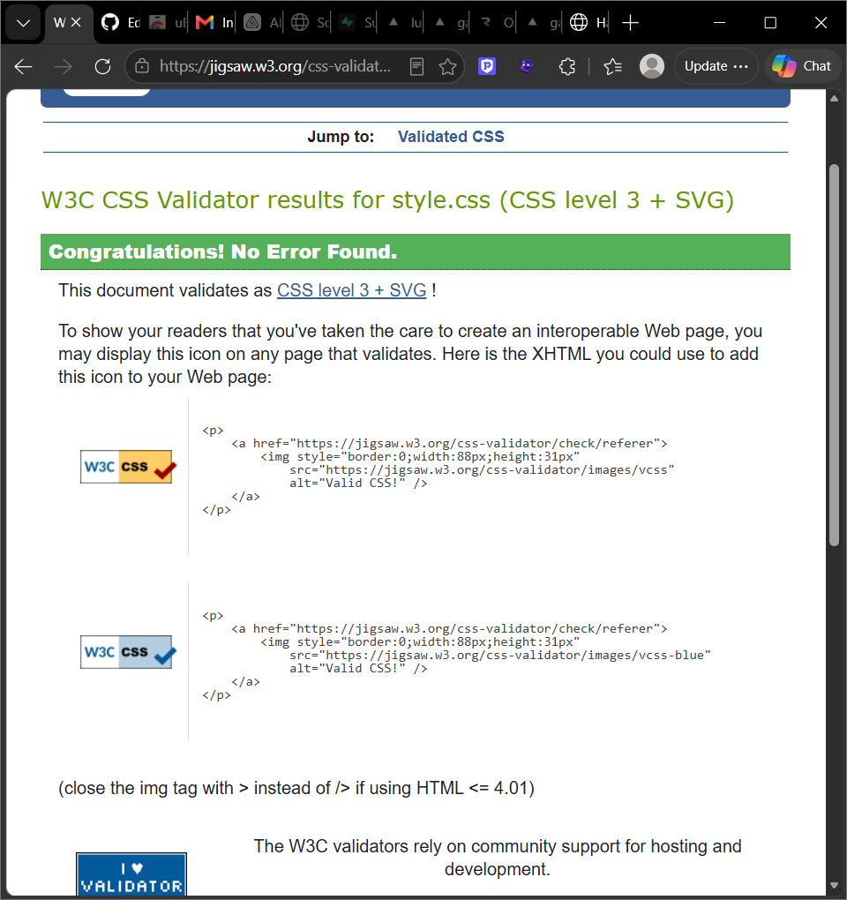

# PA1 — Styled Website · Standley Saint Leger Rock (@standley2005-ship-it)

CSDP 232 · Internet Programming · Fall 2026

## About this site

- Site I styled: the supplied Hawk Study Spots site
- Pages: `index.html`, `spots.html`, and `tips.html`
- How to view: download or clone this repository and open `index.html` in a browser.

## Color and contrast check

| Text | Text color | Background color | Contrast ratio |
|---|---|---|---|
| Body text | `#1f2937` | `rgb(248, 249, 250)` | 13.93:1 |
| Link text | `#7a1f2b` | `rgb(248, 249, 250)` | 9.68:1 |

## Cascade log

### 1. Two rules, one element

The first paragraph under “Find Your Place to Focus” has the class `intro-note`. Two selectors set its `color`:

- `.intro-note` has specificity `(0,1,0)` and sets the color to `#6b21a8`.
- `#welcome .intro-note` has specificity `(1,1,0)` and sets the color to `#7c2d12`.

`#welcome .intro-note` wins because it includes an ID selector, so its specificity is higher. The `.intro-note` color is crossed out in DevTools.

### 2. Inheritance

The `intro-note` paragraph inherits `font-family` from the `body` rule. DevTools shows that the font comes from the parent. `background-color` is not inherited. The paragraph stays transparent while the white background from `#welcome` shows behind it.

### 3. DevTools evidence

The screenshot shows the `.intro-note` color declaration crossed out and the `#welcome .intro-note` color declaration winning because it has higher specificity.

## Validation

The final CSS has 0 syntax errors. The W3C CSS Validator screenshot is saved below.

## AI use statement

I only used AI for brainstorming.
